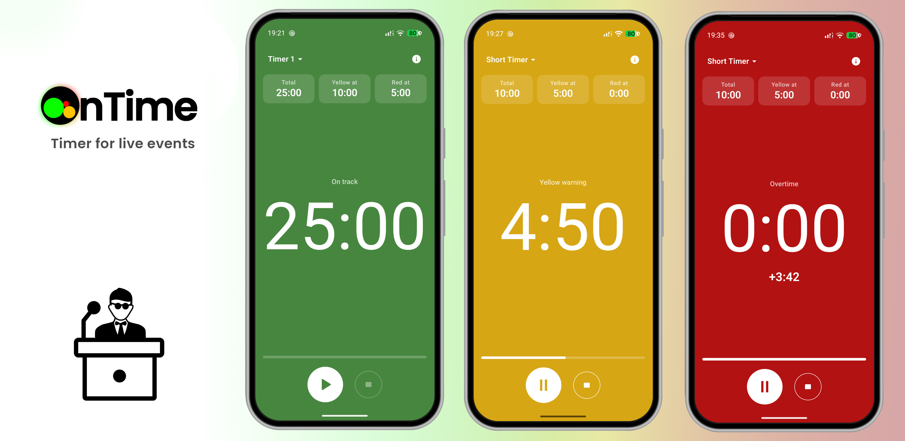
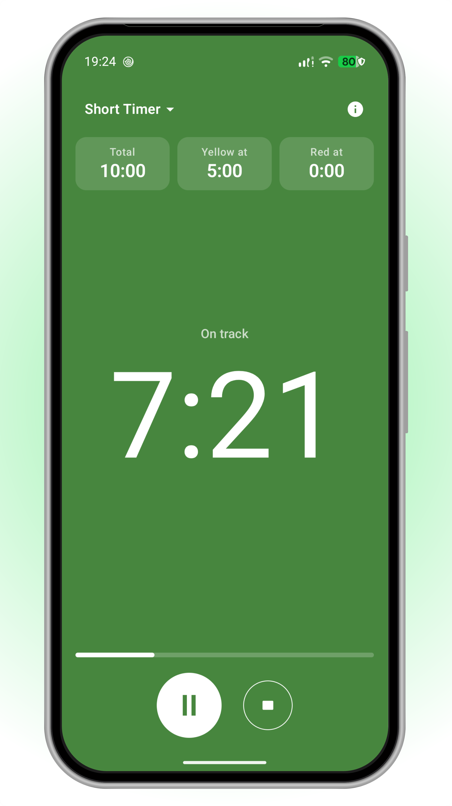
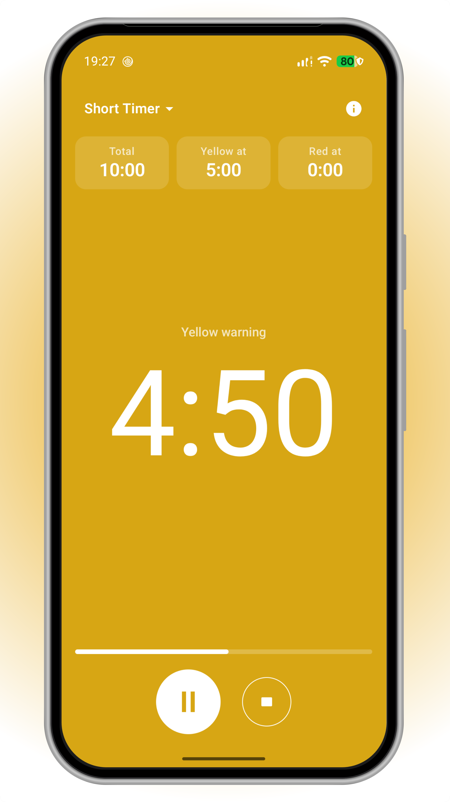
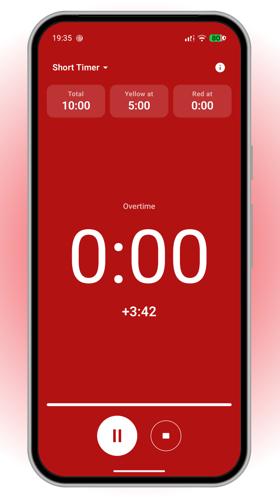
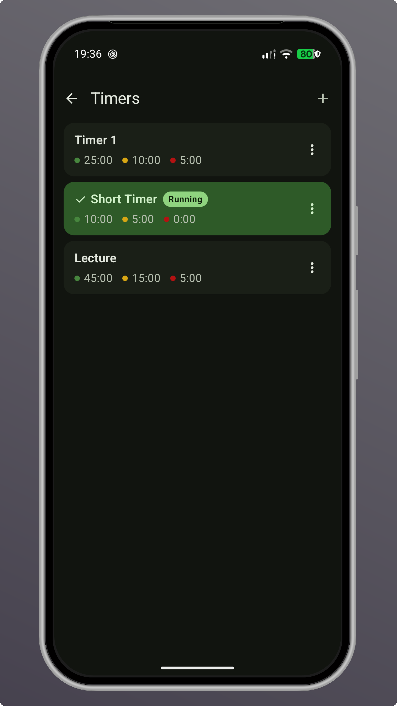

   [](https://github.com/jakobkreft/OnTime/releases)

[](https://f-droid.org/packages/si.jakobkreft.ontime/)

<div style="white-space: nowrap;">
  <a href="https://play.google.com/store/apps/details?id=si.jakobkreft.ontime&pcampaignid=MKT-Other-global-all-co-prtnr-py-PartBadge-Mar2515-1" style="display: inline-block;">
    
  </a>
  <a href="https://f-droid.org/packages/si.jakobkreft.ontime" style="display: inline-block;">
    
  </a>
  <a href="https://github.com/jakobkreft/OnTime/releases/latest" style="display: inline-block;">
    
  </a>
</div>

**OnTime** is a presentation timer you can read from across the room. The screen turns green,
yellow, then red as your time runs out, and keeps counting if you go over.

Try it in your browser: [live demo](https://jakobkreft.github.io/Projects/PresentationTimer/index.html).

## Screenshots

| Running | Wrapping up | Overtime | Saved timers |
|:--:|:--:|:--:|:--:|
|  |  |  |  |

## Features

- The whole screen turns green, yellow and red
- Set your own warning times
- Keeps counting past zero
- Save as many timers as you like
- Hide seconds for a calmer clock
- Full-screen clock in landscape
- Screen stays on
- No ads, no tracking, no permissions

## Usage

1. Tap the times at the top to set the total and the warnings, typed as `25:00`, `25m` or `1h30m`.
2. Press play.
3. Tap the timer's name to switch timers or add a new one.

Warnings are time remaining: red at `5:00` turns the screen red with five minutes left. Set a
warning to `0:00` to skip it.

## Building

You need JDK 17+ and the Android SDK.

```sh
./gradlew assembleDebug           # debug APK
./gradlew testDebugUnitTest lint  # unit tests and static analysis
./gradlew assembleRelease         # unsigned release APK (F-Droid, GitHub)
./gradlew bundlePlay              # unsigned bundle for Google Play
```

Release builds are reproducible. `app/src/main/assets/adi-registration.properties` proves
ownership of the package name; it ships in every APK, so it isn't a secret.

## Architecture

Kotlin and Jetpack Compose, one activity.

- `domain/`: duration parsing and what the clock shows at any moment. Pure and unit-tested.
- `data/`: timers and run state, saved as one JSON document.
- `ui/`: the view model and the screens.

A running timer stores when it started, not how far it got, so rotating, closing the app or
changing the system clock can't throw it off.

## Contributing

Bug reports and ideas are welcome in [Issues](https://github.com/jakobkreft/OnTime/issues/new/choose).
All text is in `app/src/main/res/values/strings.xml`, so translations are easy to add.

## License

[GPL-3.0-or-later](./LICENSE). Developed by **Jakob Kreft**.

<a href="https://ko-fi.com/jakobk"></a>
